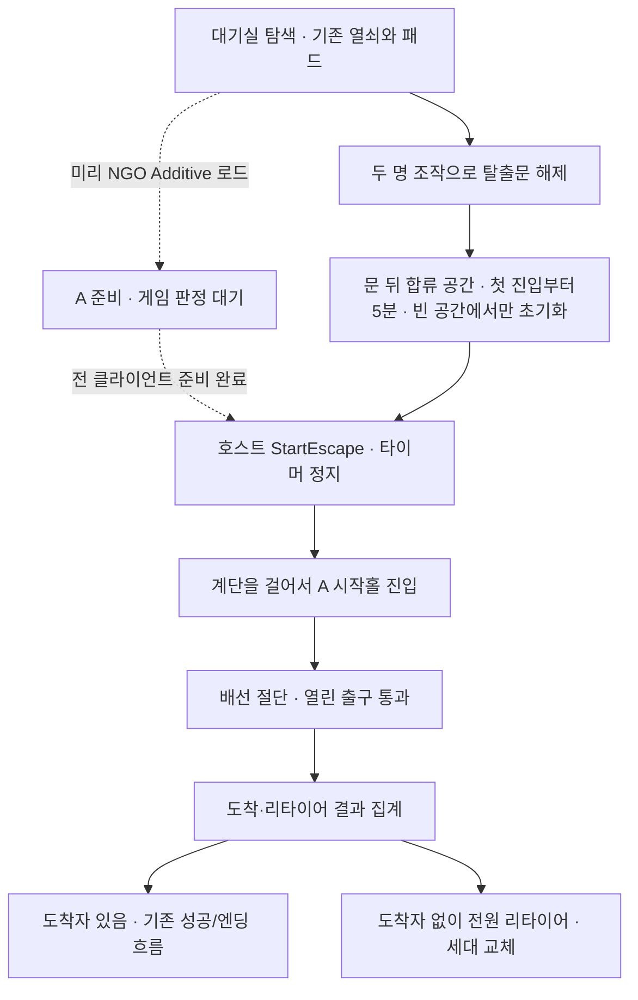

# 대기실 지하 → 탈출로 A 연속 진입 계획

2026-10-31 · 담당 @RagSpirin · `feat/exit-route/design-map` · 조사 기준 dev `341be9eb`.
사용자가 연결 구현을 승인했다. 최초 연결은 대기실 침범을 놓쳐 사용자 지적 후 수정했다. A를 서쪽60m 이전해 frame(-100,-16,118.3)/Y180도로 저장하고 지하 통로를 연장했다. 전체 메시9m 분리·시설 충돌301→0·연결417점·EditMode135/135, 실제4인 Play는 중지 유지로 미실행이다. 아래 최초 조사와 구현 계획의 최종 결과는 [현황](../../../Harness/Project/Facts/escape-waiting-transition.md)을 기준으로 한다. commit/push 없음.
후속 요청 반영: 대기실 지하 문에서 로딩 화면 없이 A 시작점으로 걸어 들어간다. 아래 사전 로드·계단 연결안이 이전 커튼/Single 교체·4스폰 재배치안을 대체한다.

## 구현 전 조사한 흐름

| 구간 | 실제 구현 | 연결 상태 |
|---|---|---|
| 접속 → 시작 로비 | `StartLobbyFlow`가 NGO로 `Lobby` 로드 | 기존 사용 |
| 로비 → 공연 → 대기실 | `CampaignRun.StepChanged` → `SpaceRoute` → `SpaceLinkDirector` | 공연별 씬과 `WaitingRoomBase` 연결 |
| 대기실 탐색 | `keepWaitingRoomOnExit=true`, exploration도 `WaitingRoomBase` | 같은 씬에서 이동 |
| 대기실 탈출문 | `StructureAExitRoute`/`ExplorationGate`: 탈출 열쇠2개+키패드 해제, 서로 다른 열쇠 구멍에서 두 명 F | 문 해제까지. 실제 `StartEscape()` 호출 없음 |
| 탈출로 전환 | `StartEscape()`가 RestTime→Escape/타이머 정지, Director가 호스트 NGO Single 로드 | 설정은 `DummyEscapeRoute`; 이 씬은 빌드 목록에서 비활성 |
| 실제 A | `escape_route`는 빌드 등록, 4스폰·원본 이동/협동·화염·절단 출구 존재 | 공용 런 진입/완료 연결부 없음 |
| A 출구 | `EscapeExitSaw.DoorOpen`: 배선24개 절단으로 양개문 개방 | 실제 도착 집계·`EndEscape()` 호출 없음 |
| 공용 탈출 결과 | `EndEscape(true)`→Ending/세션 Ended/Lobby, false→새 세대 첫 공연 | 결과를 보내는 실제 A 연결 필요 |

근거: [SpaceRoute](../../../Assets/Scripts/Systems/SpaceLink/SpaceRoute.cs), [Director](../../../Assets/Scripts/Systems/SpaceLink/SpaceLinkDirector.cs), [RunState](../../../Assets/Scripts/Systems/Campaign/RunState.cs), [공통 세팅](../../../Assets/Resources/Settings/GameSettings/BaseGameSettings.asset), [대기실 문](../../../Assets/Scripts/WaitingRoom/Exploration/StructureAExitRoute.cs), [A 출구](../../../Assets/Scripts/EscapeRoute/EscapeExitSaw.cs).

## 연속 진입 방식

- 대기실 진입 로드가 완료된 뒤 호스트가 NGO로 A를 미리 Additive 로드한다. 실제 문 통과 때는 새 로드·커튼·플레이어 재스폰 없이 두 공간을 함께 유지한다. 공연/로비의 기존 전환은 유지한다.
- 물리 동선 제안: **기존 지하 탈출문 → 짧게 꺾이는 하행 계단/연결참 → A 시작홀 뒤쪽 새 출입구 → 기존 전망과 첫 기믹**. 모퉁이와 벽으로 시야를 가렸다가 시설의 큰 공간을 보여준다. 기존 시작홀을 건너뛰지 않는다.
- 계단은 4인이 통과할 폭과 중간참·천장 여유를 확보하고, 충돌은 연속 경사로로 만들어 부상자도 통과할 수 있게 한다. 틈·낙상 단차·외부 노출·목마 머리 충돌을 검사한다. 세부 치수는 Editor 배치 후 확정한다.
- 저장 씬 기준 대기실 문은 (-13.5,-10,93.35), A의 기존4스폰은 X23~24.5/Y0.05/Z9.25~10.75로 직접 맞닿아 있지 않다. 두 접속 앵커와 공간 배치를 맞춰 연결한다. A 이동 시 `EscapeFallVoid`의 월드 범위/높이·`EscapePursuitFire.safeExitX`·대포 flightFloorHeight 등도 함께 보정하고, 조명/콜라이더/메시를 같은 기준으로 옮긴다.
- 현재 Additive 분기도 이전 공간을 먼저 닫고 커튼을 사용한다. 설정만 바꾸는 방식으로는 불가능하며 `SpaceLinkDirector`에 사전 로드와 실제 진입을 구분해야 한다.
- 로드 작업 자체는 필요하다. 사전 준비로 문 앞 로딩 화면을 없애는 것이 목표이며 프레임 멈춤0은 보장하지 않는다. 모든 참가자의 준비가 끝나기 전 빈 공간에 진입시키지 않고, 드문 지연/실패는 실제 문 잠금·준비 표시로 알린다.

## 제안하는 연결 흐름

생존 전원 집결·상호작용과 도착자1명 이상 성공은 [기획 기준](../../../Harness/Project/Facts/game-flow.md)에 있다. **2026-10-31 사용자 확정:** 참가자 전원이 도착하거나 리타이어할 때까지 기다리고, 도착자가 한 명 이상이면 성공한다. 도착자 없이 전원 리타이어하면 실패하며 첫 도착만으로 즉시 끝내지 않는다. [확정 결정](../../../Harness/Project/Decisions/escape-completion.md). 전원/희생 탈출 구분·트루 엔딩 연출은 미정으로 남긴다.

## 구현 순서와 완료 기준

1. **실제 문·계단·A 시작홀 연결**
   - [확정 입장 규칙](../../../Harness/Project/Decisions/escape-entry.md): 첫 진입부터 독립5분, 공간이 비어야 초기화, 정확히4인 합류 즉시 출발. 만료 후 전원 퇴실까지 재시도 불가. 대기실 시계와 문 해제 진행은 유지한다. 계단 끝에서 각자1인칭으로 전환한다.
   - 활성 `WaitingRoom_LayoutA/B1_EscapeEntrance`와 A 시작홀 뒤쪽에 접속 앵커를 잡고 실제 문/계단을 연결한다. 기존 열쇠/키패드/두 사람 문 조작은 유지한다.
   - `ExplorationState.IsOpen(StructureAKeyRoute.EscapeDoor)`와 현재 RestTime, 전원 연결참 진입·A 준비 완료를 호스트가 재검사해 `CampaignRun.StartEscape()`를 한 번만 호출한다. 추가 출발 버튼/로드 확인창 없이 걸어 들어가는 안이다. 기존 문 F 조작과 전원 집결 취지는 유지한다.
   - 문 해제와 탈출 시작은 별개다. 연결참에서 `집결 2/4`를 표시하고 준비되면 계단으로 진행하게 한다. 확정 전에는 되돌아올 수 있고, 확정 후 후방 문을 닫는 방식으로 대기실 진행과 분리하는 안이다.
   - 기존 `StageEntranceGather`는 공연 입구/시간 만료 안전 판정도 소유하므로 그대로 탈출문에 붙이지 않는다. 인원·영역 판정 방식을 재사용한 작은 탈출 입구 연결부를 둔다.
2. **사전 로드와 콘텐츠 활성화 분리**
   - `EscapeRouteScene`은 `escape_route`로 연결하고 대기실→A만 사전 Additive 로드/공존 경로를 사용한다. 기존 세션/자금/탐색 진행/캐릭터를 유지하며, 일반 씬 전환과 NGO 로드 요청이 동시에 실행되지 않게 직렬화한다.
   - `LoadEventCompleted`와 참가자별 콘텐츠 준비를 확인한다. 준비 상태는 세대·진입 명부에 묶고 지연/실패/이탈을 처리한다. 탐색 시계가 흐르는 동안 단순 로드 지연으로 플레이어를 가두지 않도록 일찍 준비한다.
   - 사전 로드는 `Current`·활성 씬·대기실 조작/스폰을 바꾸지 않는다. 실제 탈출 진입 때만 콘텐츠 문맥을 전환한다. `PlayerSpawnPoints.current`, 카메라/AudioListener/EventSystem, 조명·Volume, `HumanCannonSystem`의 전역 등록/조작 바인딩을 조사해 중복·선점 없이 공존시킨다.
   - 기존 플레이어가 문과 계단을 직접 통과하므로 일반 진입에서 4스폰 재배치는 하지 않는다. 4스폰은 A 직접 개발 실행용으로 유지한다. `CampaignPerformanceEntry`의 준비 확인 패턴만 참고하고 신체 복구·세션 재생성·Restart 없이 부상과 소지품을 유지한다.
   - A가 미리 로드돼도 대기실 참가자를 낙사/화염/기물로 판정하지 않게 콘텐츠/영역/Phase를 제한한다. NGO 오브젝트의 스폰 수명과 게임 판정 대기를 구분하고, `Awake`/`OnEnable`에서 이미 전역을 선점하는 항목도 처리한다.
   - 공용 런으로 들어온 A에서는 개발 낙사 보호·자동 복구·1키 검토 비행을 제한한다. 직접 A를 여는 개발 검토 기능은 기존 용도를 유지한다. 현재 기존 세션에서는 자동 호스트/재시작 소유권 가드가 있으므로 이를 활용한다.
   - `SpaceLinkDirector.TransitionRequest.Matches`는 지금 공연 요청만 검증한다. 사전 준비·탈출 요청도 Phase/세대가 바뀌면 폐기한다. 탈출 미선택으로 다음 공연에 가거나 종료/접속 해제 시 준비된 A를 정리한다. 대기실 해제는 전원 통과·후방 차폐 후 안전하게 수행한다.
3. **공용 UI와 상태 유지 보완**
   - `CommonMenuUI` 지원 공간, `CommonInventoryUI` 표시/1·2키, 음성 씬 목록에 실제 A를 반영한다. 기존 상호작용 UI와 카메라/관전 연결을 재사용한다.
   - `ExplorationState`의 런 내 문 해제 진행, `PropCarry` 소지품/내구도, 자금·부상·참가자 ID가 전환 전후 유지되는지 확인한다.
   - 리타이어 시 소지품 소실은 기획에 있지만 현재 `PropCarry`에서 실제 연결을 찾지 못했다. 공용 소지품 상태를 호스트가 정리하는 연결을 보완하고 세대 교체의 가판대 계승과 구분한다.
4. **A 출구와 성공·실패 연결**
   - 문 바깥 안전한 도착 구역을 명시하고, 문 개방+준비 완료+실제 위치로 도착을 확정한다. 문이 열린 것만으로 성공 처리하지 않는다.
   - 진입 명부별 도착/리타이어를 호스트가 기록한다. 지연·중복 메시지는 무시하고, 이탈자는 남은 인원에서 정리하되 확정한 도착 이력은 유지한다.
   - `InjuryRevival`의 Escape 생존 규칙과 기존 관전을 사용한다. 모든 사망자는 리타이어이며 같은 탈출에서 자동 부활하지 않는다.
   - 전원 도착/리타이어 확정 후 도착자1명 이상이면 `CampaignRun.EndEscape(true)`, 도착자0명이면 `EndEscape(false)`를 한 번만 전달한다. 진행 중인 사람이 있으면 종료하지 않는다. 단계 변경 직후부터 이전 A의 피해/입력/장치 판정을 막아 다음 세대 부활자가 옛 화염에 다시 죽지 않게 한다.
5. **동작별 검증 후 실제 다인 전환 확인**
   - EditMode: 문 미해제/인원 부족/전원 집결/중복 진입/비호스트 요청/잘못된 Phase/인원0/이탈/결과 중복, 첫 도착 후 계속 진행·전원 결과 확정 후 성공·전원 리타이어 실패 판정 검사.
   - 씬·통합: 계단 연결/외부 노출/부상 이동/좌표 보정, 사전 로드 중 대기실 조작·카메라·조명·음성·스폰 유지, 두 공간의 기물 전역 충돌, 일반 진입의 재스폰/커튼 없음, 부상·기물·탐색 진행 유지, 지연/실패/취소 정리, 콘텐츠 대기 중·종료 후 피해, 기존 대기실→공연 회귀.
   - 실제 플레이 중지 지시가 해제된 뒤 Unity Multiplayer Play Mode 메인+클라이언트3개로 대기실→A→성공 및 전원 리타이어→새 세대를 확인한다. 합성/1인 테스트와 실제4인 결과를 별도로 기록한다.
   - 동시 상주 메모리·로드 활성화 프레임 시간·4인 로드 완료와 문 통과 순간을 측정한다. 연결 검증 뒤 전체 맵 완주 검증을 별도 수행한다. 현재 단계에서는 실행하지 않는다.

## 구현 대상과 경계

| 역할 | 주 변경 지점 |
|---|---|
| 대기실 입구/안내 | `WaitingRoom/Base`의 집결 방식, `Exploration/ExplorationState`·실제 문 참조, `WaitingRoomBase.unity` |
| 사전 로드/공존/진입/종료 | `Systems/SpaceLink`, `EscapeRoute` 런 연결부·좌표 판정, `BaseGameSettings.asset`, `escape_route.unity` |
| 기존 참가자 상태 | `CampaignRun`·`InjuryRevival`·`NetworkPlayer`·`PropCarry`의 기존 API와 수명 경계 |
| 공용 화면/음성 | `CommonMenuUI`, `CommonInventoryUI`, `CommonUiSceneLoader` 기존 등록, 공통 VoiceChat 씬 설정 |

원본 기물·맵 동선·대기실 퍼즐을 재설계하지 않는다. B/C·별도 하역장 씬·추격 AI·새 엔딩 제작은 이번 연결의 선행 조건이 아니다. 0.2.0 기준이므로 0.1.0 전용4일차 DemoEnding 규칙도 변경하지 않는다.

## 근거와 남은 확인

- 저장된 씬의 실제 컴포넌트·활성 계층 감사: `.harness/local/escape-waiting-plan-20261031/scene-audit.json`. 대기실 옛 Greybox의 집결/스폰은 비활성이며 실제 LayoutA의 한 세트가 활성이다.
- 접속 위치 정적 감사: 같은 폴더 `seamless-anchors.json`. 설치된 NGO2.13.3 `NetworkSceneManager`의 Additive 로드/완료 이벤트와 현재 Director의 이전 씬 우선 해제·자동 활성 씬 선택을 확인했다.
- A는 4스폰, `useSceneGeometry=1` 외줄(공연 종료 판정 제외), 개발 낙사 보호1·검토 비행 활성. 연결 전용 진입 배치는 없다.
- 위험 근거: [배치 전 사망](../../../Harness/Project/Pitfalls/remote-player-judged-before-placement.md), [씬 해제 전 재사망](../../../Harness/Project/Pitfalls/revived-before-performance-unload.md).
- 저장 씬의 문/계단/출구 바닥과 몸체 여유는 정적 검사했다. 실제4인 전환 연출·지연·성능 검사는 Play 중지 지시 해제 후 수행한다.
